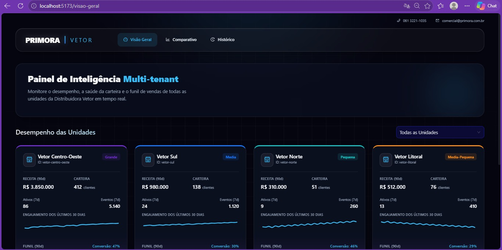
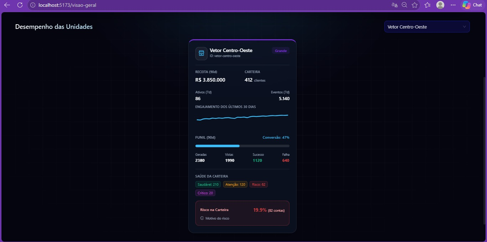
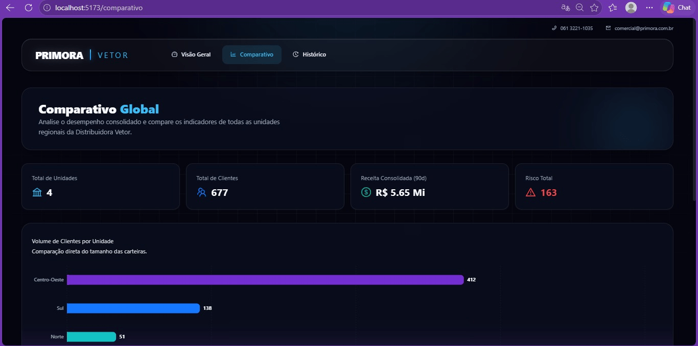
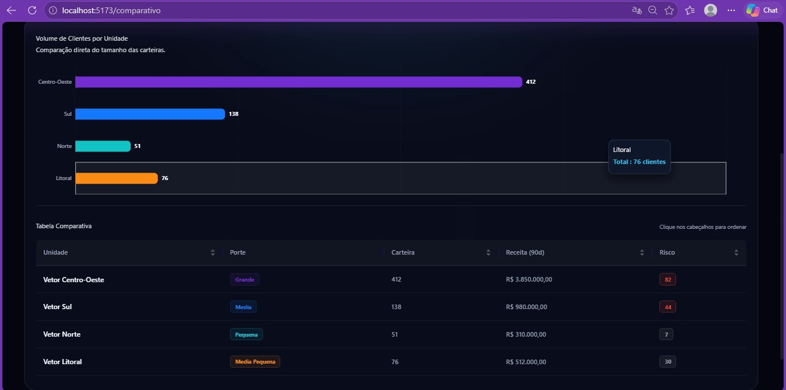
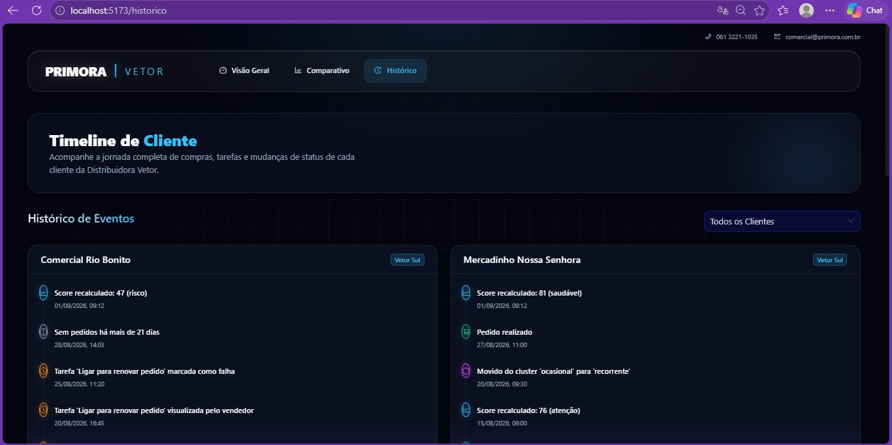

# Painel de Inteligência Multi-tenant - Distribuidora Vetor

## 1. Apresentação do Projeto
Este projeto foi desenvolvido como parte do Projeto Integrador do programa **Bolsa Futuro Digital (BFD)**, em parceria com a **Primora**. 
O desafio consiste em criar um painel web para a fictícia **Distribuidora Vetor**, que opera em múltiplas unidades regionais (tenants). O problema de negócio é a dificuldade de comparar o desempenho dessas unidades considerando seus diferentes portes. A solução é uma interface ReactJS que consome dados de uma API REST e apresenta indicadores visuais (saúde da carteira, funil, faturamento) de forma intuitiva.

## 2. Deploy e Configuração da API 
O projeto é dividido entre o Frontend hospedado na Vercel e o Backend (Workflow) rodando no n8n. O frontend consome a API REST diretamente, substituindo o uso de arquivos JSON locais.

### 2.1. Links de Produção
- **Frontend (Vercel):** [https://painel-multitenant-m6p1.vercel.app](https://painel-multitenant-m6p1.vercel.app)
- **API Backend (n8n):** `https://n8n.incluc0de.com.br/webhook/primora/v1`
  
### 2.2. Configuração de Ambiente (Local)

O frontend agora consome a API REST do workflow n8n em vez do arquivo JSON local durante a execução das telas.

Crie um arquivo .env.local na raiz do projeto com:

```env
VITE_API_BASE_URL=https://n8n.incluc0de.com.br/webhook/primora/v1
```


Endpoints utilizados:

GET /unidades → retorna as unidades

GET /clientes → retorna os clientes e seus eventos/healthSeries

Se a API não responder ou houver CORS, a interface exibirá mensagem de erro visualmente sem quebrar a aplicação.

**O projeto está configurado para funcionar imediatamente com a API padrão do n8n.**


## 3. Repositórios do Projeto
- **GitHub:** [https://github.com/marilluantunes/painel-multitenant](https://github.com/marilluantunes/painel-multitenant)

## 4. Visão Geral
- **Domínio:** Inteligência de dados comerciais e monitoramento de saúde de clientes.
- **Entidades Principais:** `Unidade` (Tenant) e `Cliente`.
- **Origem dos Dados:** A aplicação consome dois endpoints REST (GET) fornecidos pela API do n8n, que retornam dados simulados no formato JSON.

## 5. Tecnologias Utilizadas
- **React 19** (com Vite 7)
- **JavaScript** (ES6+)
- **Ant Design 6** (Componentes visuais e Design System)
- **React Router 7** (Navegação SPA)
- **Fetch API** (Integração HTTP nativa)
- **POO e Padrão DAO** (Data Access Object)

## 6. Desafio Atendido e Limitações
- **Implementado:** Navegação SPA, leitura de dados via API externa, renderização dinâmica de cartões, tabelas, timeline, filtros via `Select`, encapsulamento de dados em Classes e tratamento de erros e carregamento.
- **Limitações:** A API fornecida é apenas de leitura (GET). Não há persistência de novos dados (POST/PUT/DELETE) nem autenticação real de usuários.

## 7. Requisitos Funcionais (RF)
| Código | Requisito | Situação |
| :--- | :--- | :--- |
| RF01 | Exibir unidades com nome e porte. |  Atendido |
| RF02 | Apresentar carteira, engajamento e funil. | Atendido |
| RF03 | Distribuição de saúde da carteira. |  Atendido |
| RF04 | Filtrar uma unidade. |  Atendido |
| RF05 | Comparativo proporcional. |  Atendido |
| RF06 | Ranking / Ordenação. |  Atendido |
| RF07 | Selecionar cliente e ver eventos. | Atendido |
| RF08 | Timeline visual de eventos. |  Atendido |
| RF09 | Métrica em gráfico e tabela. | Atendido |
| RF10 | Tendência histórica. |  Atendido |
| RF11 | Tratar ausência de dados. |  Atendido |
| RF12 | Filtrar/ordenar tabelas. |  Atendido |

## 8. Requisitos Não Funcionais (RNF)
- **Arquitetura:** Separação clara entre componentes visuais, classes de domínio e DAOs.
- **Usabilidade:** Componentes do Ant Design garantem consistência e feedback visual (Spinners e Alertas).
- **Responsividade:** Grid adaptável do Ant Design.
- **Integração:** Tratamento assíncrono seguro com `try/catch` e verificação de `response.ok`.

## 9. Telas da Aplicação

**Tela 1 - Visão Geral:**




**Tela 2 - Comparativo:**




**Tela 3 - Histórico de Clientes:**



## 10. Integração com API REST
A integração é feita via `fetch` no arquivo `src/config/api.js`.
- **GET `/unidades`**: Retorna o array de unidades.
- **GET `/clientes`**: Retorna o array de clientes com seus eventos aninhados.

*Tratamento de Erros:* A API é validada com `response.ok`. Se falhar, a camada de DAO lança um erro que é capturado pela interface, acionando o componente `Alert` vermelho na tela.


## 11. Executar localmente

Clone o repositório e entre na pasta do projeto:

```bash
git clone https://github.com/marilluantunes/painel-multitenant.git
cd painel-multitenant
```

Instale as dependências e inicie o servidor de desenvolvimento:

```bash
npm install
npm run dev
```

Abra no navegador o endereço informado pelo Vite no terminal. Por padrão, é `http://localhost:5173/`.

Se o projeto já estiver baixado, execute os comandos a partir da pasta que contém o `package.json`:

```bash
npm install
npm run dev
```

## 12. Rotas

| Caminho | Tela |
| --- | --- |
| `/` | Redireciona para Visão Geral |
| `/visao-geral` | Indicadores e desempenho das unidades |
| `/comparativo` | Comparação entre unidades |
| `/historico` | Histórico de atividades dos clientes|

## 13. Comandos disponíveis

| Comando | Descrição |
| --- | --- |
| `npm run dev` | Inicia o servidor de desenvolvimento do Vite. |
| `npm run build` | Gera a versão de produção em `dist/`. |
| `npm run preview` | Serve localmente a versão de produção já compilada. Execute `npm run build` antes. |
| `npm run lint` | Analisa o código com Oxlint. |

## 14. Estrutura principal

```text
painel-multitenant/
│
├── docs/
│   └── imagens/
│       └── desktop/
│           ├── card-modelo.png                      # Imagem de referência do modelo dos cartões
│           ├── comparativo-grafico-tabela.png       # Tela de comparativo com gráficos e tabela
│           ├── comparativo.png                      # Captura de tela da página de comparativo
│           ├── historico.png                        # Captura de tela da página de histórico
│           └── visao-geral.png                      # Captura de tela da página de visão geral
│
└── src/
    ├── App.jsx                 # Configura o BrowserRouter da aplicação
    ├── main.jsx                # Ponto de entrada do React e importação do Ant Design
    ├── index.css               # Estilos globais (reset de margens)
    ├── App.css                 # Estilos adicionais (mantido vazio)
    │
    ├── data/
    │   └── dataset_painel_multitenant.json  # Fonte de dados oficial (JSON)
    │
    ├── layout/
    │   └── MainLayout.jsx       # Estrutura visual compartilhada entre as páginas
    │
    ├── routes/
    │   └── AppRoutes.jsx       # Definição das rotas conectando URLs aos componentes
    │
    ├── components/
    │   ├── visaogeral/
    │   │   ├── VisaoGeral.jsx      # Tela principal com filtro e mapeamento dos cartões
    │   │   └── CardUnidade.jsx     # Componente reutilizável (Props) com métricas da unidade
    │   │
    │   ├── comparativo/
    │   │   └── Comparativo.jsx       # Tela com a tabela comparativa
    │   │
    │   └── historico/
    │       └── Historico.jsx       # Tela com a timeline de eventos dos clientes
    │
    └── objetos/
        ├── dominio/
        │   ├── Unidade.mjs
        │   ├── Cliente.mjs
        │   ├── Evento.mjs
        │   └── RegistroSaude.mjs
        │
        └── dao/
            ├── UnidadeDAO.mjs
            └── ClienteDAO.mjs

```


## 15. Equipe

- Maria Luiza Antunes (@marilluantunes)
- Atila Kenoly (@Hirahoshi)
- Augusto
